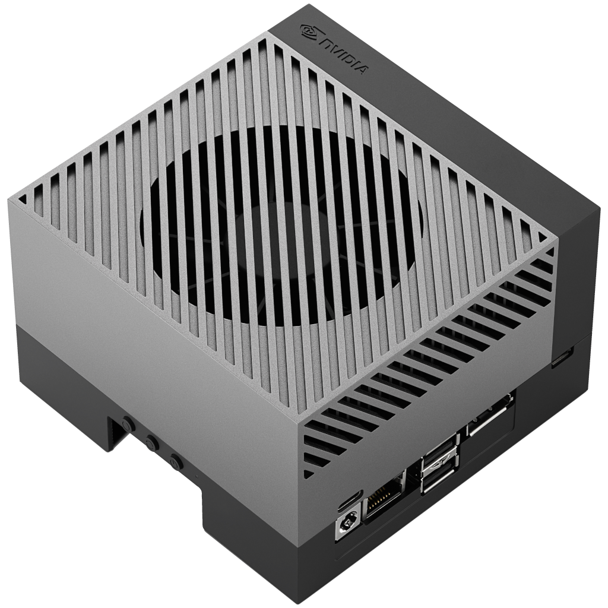

# Panoramica del prodotto

Il kit di sviluppo NVIDIA® Jetson AGX Orin™ è il kit di sviluppo di punta della
famiglia Jetson Orin: un computer compatto per l'IA dedicato allo sviluppo e
alla prototipazione di applicazioni di robotica, computer vision e IA
generativa in ambito edge. Questa guida riguarda il kit di sviluppo da **64GB**.

## Dati chiave (verificati sulla documentazione NVIDIA)

- Il kit di sviluppo condivide **un'unica architettura SoC con tutti i moduli
  Jetson Orin**, quindi può **emulare le prestazioni e la potenza** dei moduli
  AGX Orin, Orin NX o Orin Nano con un nuovo flashing. Di fabbrica viene
  configurato per la **serie Jetson AGX Orin**. *(Developer Kit User Guide)*
- NVIDIA dichiara per la famiglia di moduli AGX Orin prestazioni IA **fino a
  275 TOPS**, con potenza configurabile tra **15W e 60W**. *(pagina prodotto
  NVIDIA)*
- La GPU del modulo da 64GB è una **GPU con architettura NVIDIA Ampere da 2048
  core e 64 Tensor Core**. *(pagina prodotto NVIDIA, tabella comparativa)*
- La scheda carrier di riferimento inclusa espone interfacce standard —
  DisplayPort, Ethernet 10GBASE-T, USB 3.2, M.2 (NVMe e Wi-Fi), connettore a
  40 pin, PCIe, connettore per fotocamera e altro ancora. Vedere
  **[Interfacce e layout hardware](./interfaces.md)**.

## A cosa serve il kit di sviluppo

- **Sviluppo e prototipazione** — il kit è la piattaforma di riferimento per le
  applicazioni che in produzione verranno eseguite sui moduli Jetson Orin.
- **Esplorazione di prestazioni e potenza** — poiché emula gli altri moduli
  Orin, un solo kit consente di provare carichi di lavoro su tutta la gamma di
  moduli prima di decidersi per un componente di produzione.
- **Carichi di lavoro di IA edge** — computer vision, robotica e IA generativa
  locale (vedere la nostra sezione tutorial, in crescita).

> **Nota di Juxi:** I prodotti di produzione si basano su *moduli* Jetson Orin
> (versioni da 64GB / 32GB / Industrial) montati su una scheda carrier propria o
> di un partner. Il kit di sviluppo è il veicolo di sviluppo, non il componente
> di produzione.

## Contenuto della confezione

Modulo Jetson AGX Orin e scheda carrier di riferimento, modulo Wi-Fi,
alimentatore USB Type-C e un cavo da USB Type-C a USB Type-A. Per ciò che
occorre procurarsi autonomamente, vedere
**[Avvio rapido](./quick-start.md)**.

## Prossimi passi

- **[Avvio rapido](./quick-start.md)** — dall'unboxing a un sistema JetPack 7.2.1 funzionante
- **[Interfacce e layout hardware](./interfaces.md)** — ogni porta e connettore
- **[Download](./downloads.md)** — immagini ufficiali, strumenti e link alla documentazione *(pagina in preparazione)*

## Fonti

- [Jetson AGX Orin Developer Kit User Guide — Introduction](https://docs.nvidia.com/jetson/agx-orin-devkit/user-guide/latest/index.html) (verificato il 2026-09-23)
- [Pagina prodotto NVIDIA Jetson Orin](https://www.nvidia.com/en-us/autonomous-machines/embedded-systems/jetson-orin/) (verificato il 2026-09-23)

**Crediti immagine:** Immagine del prodotto tratta dalla *Jetson AGX Orin
Developer Kit User Guide* ufficiale NVIDIA (scaricata il 2026-09-23), © NVIDIA
Corporation.

---

NVIDIA® e Jetson™ sono marchi di NVIDIA Corporation. Questa pagina è pubblicata
da Juxi Technology e non è una pubblicazione NVIDIA.
